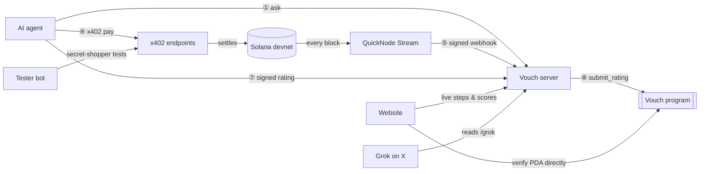

<div align="center">


# Vouch

### Yelp for AI agents, where every review is backed by a real payment.

[](https://explorer.solana.com/address/GyYPjRNghiX96xFtP98eNMiYjKfrF5ktKLf1Mm2YBgni?cluster=devnet)
[](#how-it-works)
[](#quicknode-streams)
[](#grok-bot)
[](#tests)

**Track:** Agentic Payments and AI · **Chain award:** Best use of Solana · **Bounties:** QuickNode Streams, Grok Bot

[Demo video](#) · [Program on Explorer](https://explorer.solana.com/address/GyYPjRNghiX96xFtP98eNMiYjKfrF5ktKLf1Mm2YBgni?cluster=devnet) · [Grok chat exports](grok-chat-exports/README.md)

</div>

---

## The problem

AI agents now pay for APIs on their own, a cent at a time, with x402 and USDC. But x402 settles payment on any response under 400, so a scam endpoint can return **HTTP 200 with garbage** and keep the money. Agents have no way to know who to trust *before* they pay, and normal reviews are free to fake and easy to delete.

## The solution

**Vouch gives every x402 endpoint a trust score from 0 to 100.** Agents ask Vouch before paying and rate the data afterwards. A rating counts only if:

1. a **real USDC payment** for it landed on Solana, confirmed independently by a **QuickNode Stream**,
2. it is **signed by the wallet that paid**, and
3. that payment has **never been used to rate before**, which our **Solana program** enforces permanently.

**No payment, no review.** When one agent loses one cent to a scam, every other agent stops paying it.

> Everything runs for real on Solana devnet: real x402 payments, a live QuickNode Stream, a deployed Anchor program, and Grok on X reading live scores.

---

## How it works

```
 ① Task           "Get the Bitcoin price"
 ② Ask Vouch      GET /best → endpoints ranked by trust score
 ③ Safety check   skip anything below 60, too expensive, or over budget
 ④ Pay            $0.01 USDC on Solana via x402                        → Solana tx
 ⑤ QuickNode      Stream sees the transfer, sends a signed webhook to Vouch → "verified"
 ⑥ Check data     ✓ got something  ✓ right format  ✓ makes sense  ✓ fast enough
 ⑦ Rate           GOOD or BAD, ed25519-signed by the paying wallet
 ⑧ Stamp          Vouch checks payment + signature + uniqueness → Solana program
 ⑨ Score updates  leaderboard, Grok feed and every other agent see it instantly
```

If the data is bad, the agent rates it BAD and moves on to the next-best endpoint. The next agent never pays that scam at all.



### Components

| Folder | What it is |
|---|---|
| [`agent/`](agent/) | AI agent with its own wallet. Also contains the **agent runner**, which streams each step live to the website, and the **tester bot**, a secret shopper that buys from every endpoint on a schedule |
| [`server/`](server/) | Vouch server: recommendations, payment verification, signed ratings, scoring, on-chain stamping, `/grok` feed |
| [`program/`](program/) | Anchor program that stores every rating permanently |
| [`stream/`](stream/) | QuickNode Stream filter and HMAC verifier |
| [`fake-apis/`](fake-apis/) | 9 real x402 endpoints on devnet (4 honest, 5 scams). Any one can be made a scam live |
| [`website/`](website/) | Landing page, live leaderboard with on-chain verification, and the **Live Flow** demo page |

## Tech stack

**Solana devnet** · **Anchor 1.x** (Rust, LiteSVM tests) · **x402** (`@x402/fetch`, `@x402/svm`, `@x402/express`) with the PayAI facilitator · SPL Token USDC · `@solana/kit`, `@solana/web3.js` · **QuickNode Streams** · **Node.js 22+**, Express 5, `node:sqlite` · **React 19**, TypeScript, Vite, Solana Wallet Adapter (Phantom, Solflare) · **Grok Bot on X** · Open-Meteo and CoinGecko for real-world data

---

## Agent decision loop and safety limits

**Loop** ([`agent/agent.js`](agent/agent.js)): get a task → ask Vouch for ranked endpoints (fall back to an allowlist if Vouch is down) → filter by the limits below → pay the best one with x402 → run 4 checks → submit a signed rating → if BAD, try the next candidate.

**The 4 checks** ([`agent/src/checks.js`](agent/src/checks.js)): **got something** (non-empty), **right format** (matches the published schema), **makes sense** (agrees with an independent source, Open-Meteo or CoinGecko), **fast enough** (under 3 s).

| Guardrail ([`agent/src/config.js`](agent/src/config.js)) | Value |
|---|---|
| Minimum trust score | **60** |
| Max price per call | **$0.05** |
| Budget per task | **$0.25** (including retries) |
| Unrated endpoints | only if **≤ $0.01** |
| Retries after a bad result | **2** |
| Fallback if Vouch is down | allowlist of 2 known-good endpoints |
| Demo runner rate limit | **30 runs/hour** |
| Keys | server-side `.env` only, never sent to the browser |

## Trust score

`Score = 0.4·T + 0.3·A + 0.2·H + 0.1·R` ([`server/src/scoring.js`](server/src/scoring.js))

**T** = tester bot results · **A** = agent ratings (recent ones weigh more) · **H** = human reviews from verified buyers · **R** = repeat buyers. Ratings can never lift a score more than 10 above T, so a scammer can't buy their way past the independent tester. Wallets that have only ever paid one endpoint count half. Scores under 60 are labelled `avoid`.

## Why reviews can't be faked

| Attack | Result |
|---|---|
| Fake payment ID | `400 payment_not_verified`: QuickNode never saw it |
| Rate the same payment twice | `409 payment_already_used`, and the Solana program also refuses it |
| Use someone else's payment | `403 not_the_payer` |
| Forged signature | `401 bad_signature` |
| Wrong endpoint or underpaid | `400 payment_for_different_endpoint` / `underpaid` |
| Forged QuickNode webhook | `401`: HMAC check fails |

The first four are **"Try to cheat" buttons** on the Live Flow page, and all of them are covered in [`server/test/`](server/test/).

---

## How Vouch uses Solana

**Program ID:** [`GyYPjRNghiX96xFtP98eNMiYjKfrF5ktKLf1Mm2YBgni`](https://explorer.solana.com/address/GyYPjRNghiX96xFtP98eNMiYjKfrF5ktKLf1Mm2YBgni?cluster=devnet) (devnet)

- **Payments:** agents pay in USDC (SPL Token) via x402. Solana's speed and tiny fees are what make $0.01-per-request commerce work.
- **Proof:** the payment's transaction signature is the `paymentId` that ties a rating to real money.
- **Permanent record:** the Anchor program stores every rating. Only the Vouch server's key can write (`Config.authority`). Each payment gets a `PaymentUsed` PDA (seeds: `["payment", sig]`), so `init` fails on a second rating. No instruction edits or deletes a rating. Public `EndpointRecord` PDAs (`["endpoint", id]`) hold good/bad totals, which the website's **Verify On-Chain** button reads straight from devnet.

| Other addresses (devnet) | |
|---|---|
| USDC mint | `4zMMC9srt5Ri5X14GAgXhaHii3GnPAEERYPJgZJDncDU` |
| Agent wallet | `Ft84bfshg85DA5As9mcWUdKmvjBb3YQv59onpPHggQbZ` |
| Endpoint wallets | [`fake-apis/wallets.json`](fake-apis/wallets.json) |

## QuickNode Streams

The Stream is Vouch's **independent proof that a payment happened**, so we never have to trust the agent's word. Full details: [`stream/README.md`](stream/README.md).

| Setting | Value | Why |
|---|---|---|
| Network | Solana **Devnet** | Our endpoints charge devnet USDC |
| Dataset | **Block** (full transactions with `meta`) | Token balance changes show who paid whom |
| Filter | [`stream/filter.js`](stream/filter.js) | Keeps only successful transactions where the USDC balance of one of our 9 endpoint token accounts went up. Everything else is dropped |
| Destination | Webhook → `/webhook/quicknode` | Server marks the `paymentId` as verified |
| Security | Stream token → `QN_STREAM_SECRET` | Server checks the `X-QN-Signature` HMAC on every delivery |

**Why we read balance changes:** the transaction's first signer is the facilitator paying the fee, not the buyer. The debited USDC account's owner is the real payer. This also handles both `transfer` and `transferChecked`.

## Grok Bot

Grok Bot is how people and their agents act on Vouch's scores without leaving X. The server publishes a live plain-text [`/grok`](server/src/grok.js) feed with current scores, which APIs to avoid and why, what to switch to, and a Solana proof link for every bad rating. Grok uses it to recommend APIs, checks the proof transactions itself on Solana, and runs an **hourly automation** that alerts users when an API is caught scamming.

**Chat exports** ([`grok-chat-exports/`](grok-chat-exports/README.md)): [1. recommends an API](https://grok.com/share/c2hhcmQtMi1jb3B5_10667e27-306c-4591-b8e9-c4e284ea51cf) · [2. scam warning](https://grok.com/share/c2hhcmQtMi1jb3B5_d82bec33-cbfa-4867-b280-58839e6a48fb) · [3. verifies on-chain proof](https://grok.com/share/c2hhcmQtMi1jb3B5_bdc54411-e32b-4ff6-8373-9d200eab864d) · [4. hourly monitor](https://grok.com/share/c2hhcmQtMi1jb3B5_6be2297b-60ab-405b-8dd2-b61428f375e0)

**Screenshots:** [advice](grok-chat-exports/chat-1-advice.png) · [monitor setup](grok-chat-exports/chat-2-monitor-setup.png) · [hourly alert](grok-chat-exports/chat-3-hourly-alert.png) · [acting on it](grok-chat-exports/chat-4-act.png) · [after a change](grok-chat-exports/chat-5-after-change.png)

---

## Running it

**Needs:** Node.js 22.5+. Commands use a bash shell; on PowerShell, set variables with `$env:NAME="value"`.

**Quick look (no backend):**

```bash
cd website && npm install && VITE_USE_MOCK=true npm run dev     # http://localhost:5173
```

**Full live demo (real devnet payments):**

```bash
# One-time setup
cd fake-apis && npm install && cp .env.example .env && npm run setup   # endpoint wallets
cd agent && npm install && node create-wallet.js && npm run tester:setup  # fund with devnet USDC (faucet.circle.com)
cd server && npm install && cp .env.example .env && npm run chain:setup   # server key for the program
# In server/.env set FAKE_APIS_URL=http://localhost:3005, ADMIN_TOKEN, QN_STREAM_SECRET
# In agent/.env set VOUCH_ADMIN_TOKEN to the same value as ADMIN_TOKEN

# Run (one terminal each)
cd fake-apis && PORT=3005 PAYMENTS=on node server.js
cd server && npm start                                                 # :4000
cd agent && VOUCH_URL=http://localhost:4000 PAYMENTS=on FAKE_APIS_URL=http://localhost:3005 npm run runner  # :4100
cd website && npm run dev                                              # :5173
cloudflared tunnel --url http://localhost:4000                         # public URL for QuickNode + Grok
```

Point the QuickNode Stream's webhook at `https://<tunnel>/webhook/quicknode`. No QuickNode account? Run `cd server && npm run simulate-stream`, which posts the same payload from devnet RPC. Then open **`localhost:5173/#/flow`** and press **Run agent**.

To run without any wallet, start `fake-apis` with `PAYMENTS=off`. Each folder's README covers its own routes and options.

## Tests

```bash
cd server && npm test                     # 44 tests: scoring + every cheat the server must block (all passing)
wsl -d Ubuntu -- bash program/build.sh    # Anchor build + 5 LiteSVM tests
cd stream && npm run check                # filter.js against real devnet payments
```

---

## Team

| Member | GitHub |
|---|---|
| TODO | [@ameya-d5](https://github.com/ameya-d5) |
| TODO | [@AdHi018](https://github.com/AdHi018) |
| TODO | [@ShruthaBangalore](https://github.com/ShruthaBangalore) |

<div align="center">

Built for the **University Blockchain Conference 2026 Hackathon**. **No payment, no review.**

</div>
